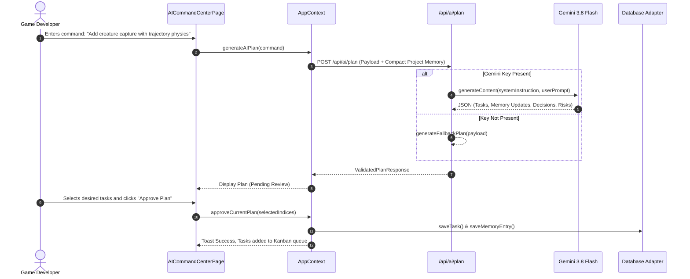
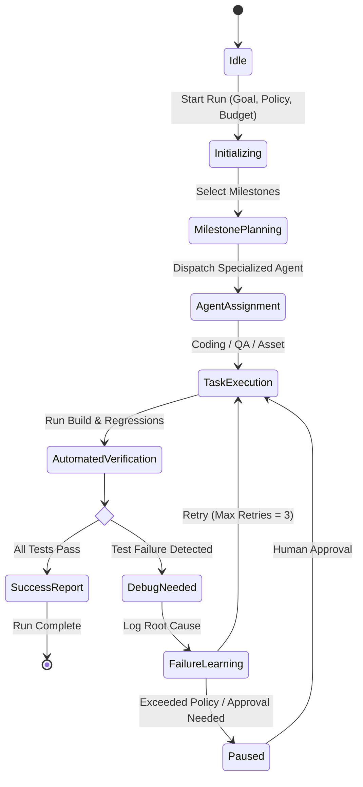
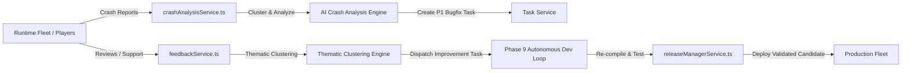

# Technical Architecture & System Workflows

This document details the architectural topology, data flows, communication interfaces, and runtime models of **AI Game Builder Hub**.

---

## 1. High-Level System Architecture

```mermaid
graph TD
    Client[React 19 SPA (Vite)] -->|HTTP / JSON Body| ExpressServer[Express Server (server.ts)]
    Client -->|Local Storage / Cache| LocalRepo[LocalRepository.ts]
    Client -.->|If FIREBASE_CONFIG| RemoteRepo[FirestoreRepository.ts]

    ExpressServer --> AIRoutes[/api/ai/*]
    ExpressServer --> GitRoutes[/api/repo-info, /api/commit]
    ExpressServer --> KnowledgeRoutes[/api/knowledge/*]

    AIRoutes --> AIOrchestrator[server/services/aiOrchestrator.ts]
    AIOrchestrator -->|@google/genai SDK| GeminiAPI[Google Gemini 3.8 Flash]
    AIOrchestrator -.->|Fallback Planner| LocalPlanner[Structured Fallback Generator]

    Client --> PreviewEngine[GamePreviewCenter (HTML5 2D Canvas)]
    Client --> AutonomousEngine[AutonomousDevelopmentService]
    Client --> ProductionHub[Release & Incident Manager]
```

---

## 2. Server API Route Specifications

| Route | Method | Purpose | Request Body / Query | Response Payload |
| :--- | :--- | :--- | :--- | :--- |
| `/api/health` | `GET` | Health check | None | `{ status: "ok", service: "AI Game Builder Hub API", phase: 8 }` |
| `/api/ai/status` | `GET` | Gemini connection status | None | `{ connected: boolean, provider: "Google Gemini", model: "gemini-3.8-flash" }` |
| `/api/ai/test` | `POST` | Live Gemini ping | None | `{ success: boolean, model: string, latencyMs: number, message: string }` |
| `/api/ai/plan` | `POST` | Structured task generation | `PlanRequestPayload` (userCommand, projectContext, memory) | `ValidatedPlanResponse` (tasks, memories, decisions, risks) |
| `/api/ai/chat` | `POST` | Multi-turn planning dialogue | `{ userMessage, currentPlan, history }` | `{ reply: string, updatedPlan?: ValidatedPlanResponse }` |
| `/api/repo-info` | `GET` | Git repository metadata | `?projectId=string` | `{ connected: true, provider: "GitHub", repository, defaultBranch, fileCount, languages, latestCommit }` |
| `/api/providers` | `GET` | Coding agent provider roster | None | `{ providers: [...] }` (Codex, Gemini, Local Sandboxed) |
| `/api/commit` | `POST` | Safe commit creation | `{ branch, message, taskId, attemptId, author }` | `{ success: boolean, commit: { hash, branch, message, committedAt } }` |
| `/api/knowledge/search` | `POST` | Deep project documentation query | `{ projectId, query }` | `{ query, totalResults, results: [...] }` |
| `/api/knowledge/import` | `POST` | Canon document ingestion | `{ projectId, title, content, category, sourceType }` | `{ success: true, document: {...} }` |
| `/api/research/query` | `POST` | Autonomous tech research | `{ projectId, query }` | `{ id, summary, findings: [...] }` |

---

## 3. Core Workflows & Data Flows

### A. AI Game Planning & Task Decomposition Workflow



---

### B. Autonomous Development Loop (Phase 9)



---

### C. Production Telemetry & Feedback Feedback Loop (Phase 10 -> Phase 9)



---

## 4. State Management Architecture

The frontend uses React's `useContext` and `useReducer`/`useState` pattern encapsulated in `AppContext.tsx`:
- **Entity Collections:** `projects`, `tasks`, `agents`, `builds`, `tests`, `assets`, `activities`, `memories`, `decisions`.
- **UI State:** `activeTab`, `sidebarCollapsed`, `commandPaletteOpen`, `searchQuery`, modal open flags.
- **AI Planning State:** `currentAIPlan`, `projectPlans`, `isPlanning`, `activeConversation`.
- **Persistence Synchronization:** When state mutating functions (`createTask`, `saveProject`, `approveCurrentPlan`) are executed, the context updates memory state immediately and asynchronously persists to `IDatabaseAdapter`.
